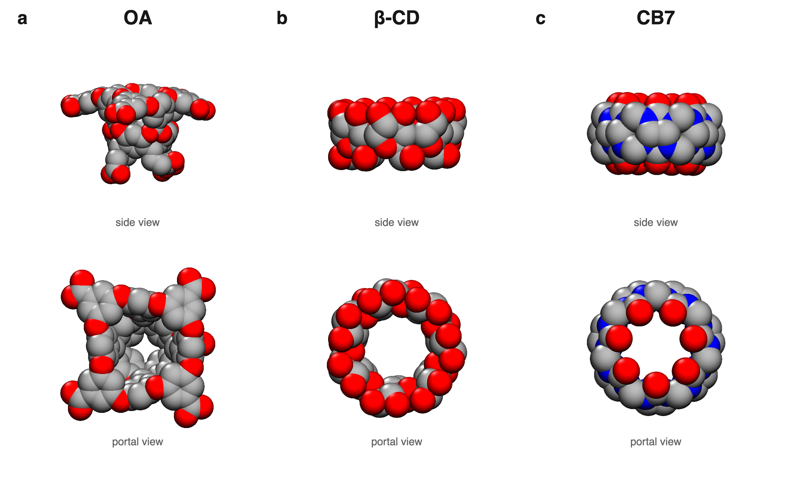

# Computational Molecular Science Portfolio

Research software and reproducible analysis by **Jakob L. Schanzer**.

This private portfolio highlights scientific computing across statistical mechanics, molecular simulation analysis, Fortran, Python, Julia, uncertainty quantification, and agent-assisted research engineering.

## Featured project: water in molecular cavities

[](projects/high-energy-water/README.md)

### Does molecular confinement create “high-energy” water?

The project tests a common mechanistic claim in molecular recognition: that confined water is uniformly energetically unfavorable and that releasing it necessarily drives binding. It combines spatial thermodynamic maps, occupancy fluctuations, hydrogen-bond statistics, temperature response, and binding-coordinate analysis for three manuscript systems: **CB7, OA, and β-cyclodextrin**.

The central result is more nuanced. Populated hydration sites are, on average, enthalpically stabilized. Sharp collective drying occurs in rigid hydrophobic cavities, but drying alone is not evidence that expelling “high-energy water” drives association.

[Explore the project, figures, physics, and code →](projects/high-energy-water/README.md)

## Featured scientific codes

| Code | Analysis performed |
|---|---|
| [`janal.f`](projects/high-energy-water/src/fortran/host_analysis/janal.f) | Processes independent unbiased trajectories and energy inputs to calculate cavity-water density, energy, chemical potential/test-particle insertion estimates, occupancy fluctuations, and axial–radial thermodynamic fields. |
| [`vol.f`](projects/high-energy-water/src/fortran/host_analysis/vol.f) | Supplies the host-following cavity-membership test used by JANAL. The checked-in six-plane implementation documents one geometry-specific production backend; other host geometries used their own `vol` input and adapted backend. |
| [`hb4.f`](projects/high-energy-water/src/fortran/hydrogen_bonds/hb4.f) | Counts water–water and water–host hydrogen bonds frame by frame under periodic boundary conditions. Ensemble counts from the bulk, host–guest, isolated-host, and isolated-guest simulations supplied the four terms used to calculate the binding hydrogen-bond balance, δ. |
| [`ring_angle.f`](projects/high-energy-water/src/fortran/ring_geometry/ring_angle.f) | Quantifies β-cyclodextrin ring orientation and inter-monomer spacing from trajectory frames. This geometry analysis supported selection and validation of the open-cavity rim restraints used in the restrained β-CD calculations; the associated free-energy offset was then obtained with a separate MBAR thermodynamic cycle. |

## Computational capabilities demonstrated

- Legacy and modernized **Fortran** analysis of independent unbiased trajectories—JANAL for cavity thermodynamics plus hydrogen-bond and host-geometry tools
- Replica-exchange umbrella sampling, WHAM reconstruction, and constant-heat-capacity thermodynamic decomposition
- Reproducible **Julia** figure generation and quantitative transition analysis
- Tested **Python** post-processing with deterministic bootstrap uncertainty estimates
- Spatial density, chemical-potential, enthalpy, and hydrogen-bond maps
- Statistical-mechanical interpretation connecting microscopic hydration to binding thermodynamics
- Geometry-aware analysis through a shared JANAL core and host-specific volume backends
- CI compilation/tests plus a constrained **Codex agent workflow** with explicit validation gates

## Portfolio roadmap

| Project | Focus | Status |
|---|---|---|
| [High-energy water](projects/high-energy-water/README.md) | Confined-water thermodynamics and collective drying | Featured; manuscript under peer review |
| Project 2 | Multiscale molecular modeling | Planned |
| Project 3 | Agentic scientific computing | Planned |

## Reproducibility

From the repository root:

```bash
make check
make test
```

Figure regeneration and data provenance are documented inside the featured project. Raw trajectories are intentionally excluded because of size and unpublished-work controls; compact processed inputs required for the displayed analyses are included.

> **Confidential research note:** this repository is private and contains results from a manuscript under peer review. Do not redistribute without the author’s permission.
