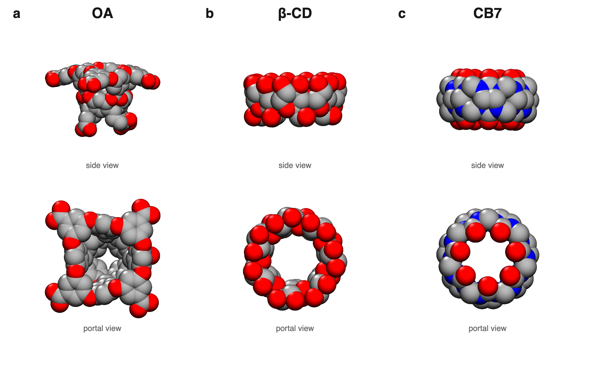
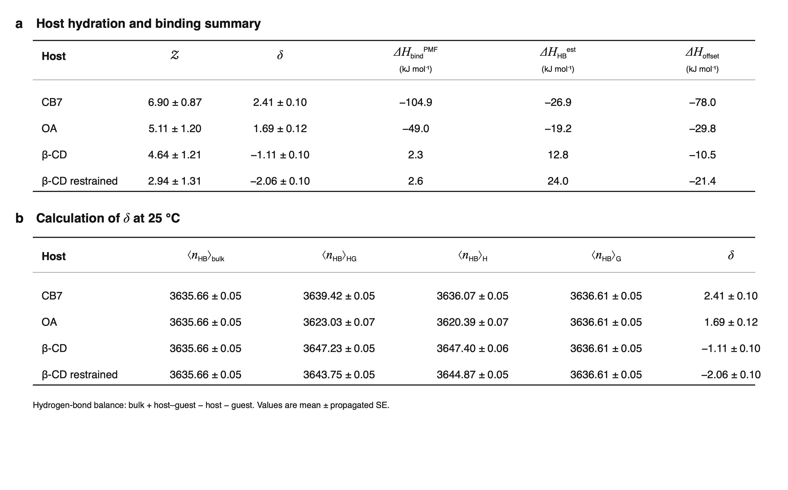
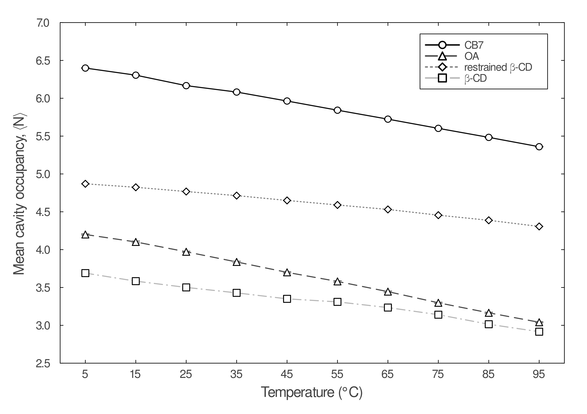
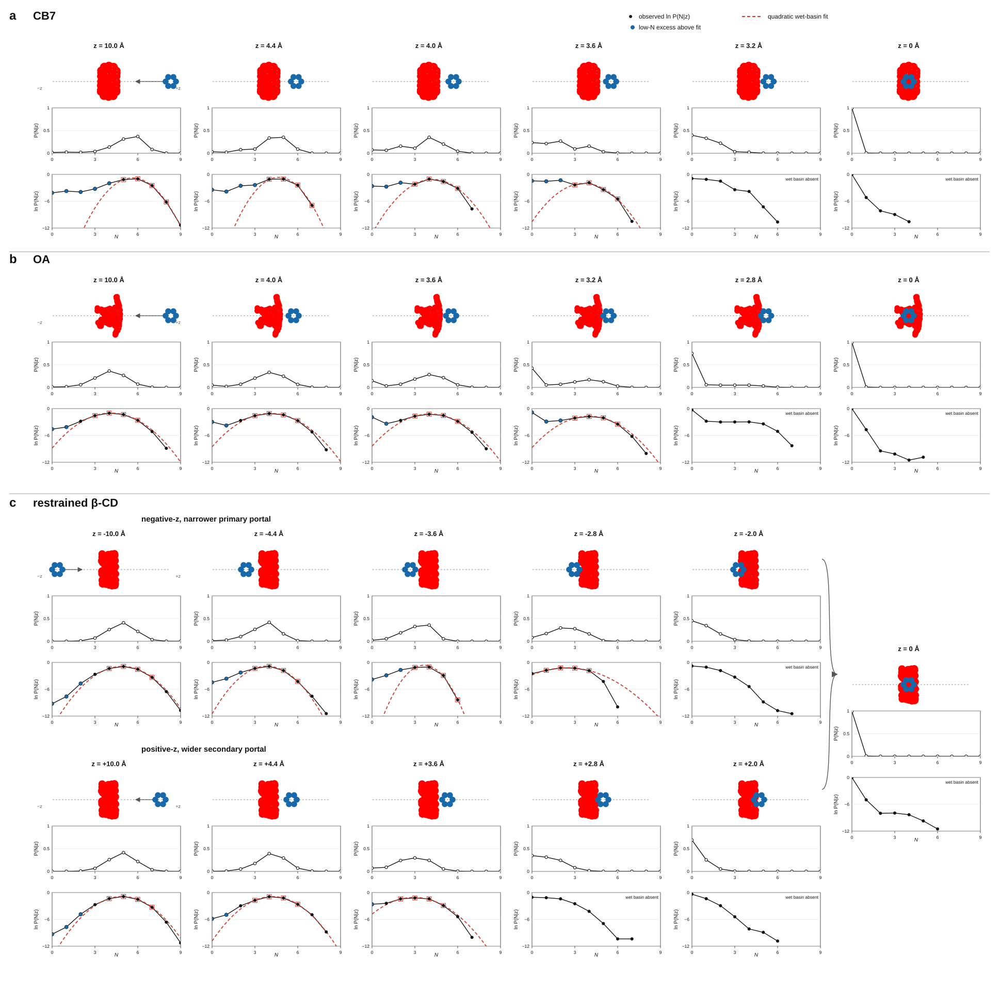

# Molecular Confinement Does Not Create High-Energy Water

**A computational study of hydration thermodynamics and collective drying in CB7, OA, and β-cyclodextrin**  
Jakob L. Schanzer · manuscript submitted and under peer review

**Scientific ownership:** I performed the underlying scientific work: simulation design and execution, development or adaptation of the core analysis programs, and data analysis. Scientific interpretation was done in conjunction with my advisor, Hank Ashbaugh, and our experimental collaborator, Bruce Gibb. I directed and verified Codex while it assembled the reproducible portfolio layer described below; scientific interpretation and publication decisions remained human-controlled.

## Computational summary

- **Methods:** molecular dynamics, 20-temperature REMD, umbrella sampling, WHAM, MBAR, constant-*C*<sub>p</sub> thermodynamic decomposition, spatial thermodynamics, occupancy-fluctuation analysis, and uncertainty quantification
- **Software:** Fortran trajectory analysis, Python post-processing and deterministic tests, Julia analysis and figure generation, GitHub Actions continuous integration
- **HPC-scale workflow:** independent 400 ns unbiased simulations, parallel replica/window calculations, and 100 ns conventional umbrella trajectories for every binding-coordinate window
- **Quality controls:** warning-enabled Fortran compilation, seeded tests, numerical audit outputs, figure regeneration, and an automated publication-boundary check

## Figures and code — direct links

**Main results:** [Figure 1 · host systems](figures/figure1_host_systems.png) · [Figure 2 · PMF decomposition](figures/figure2_pmf_decomposition.png) · [Table 1 · hydrogen-bond accounting](figures/table1_hydrogen_bond_summary.png) · [Figure 3 · temperature response](figures/figure3_temperature_response.png) · [Figure 4 · spatial maps](figures/figure4_spatial_maps.png) · [Figure 5 · mean occupancy](figures/figure5_mean_occupancy_vs_z.png) · [Figure 6 · occupancy distributions](figures/figure6_occupancy_distributions.svg)

**Detailed P(N|z) panels:** [CB7](figures/cb7_pn_lnpn_paired.png) · [OA](figures/oa_pn_lnpn_paired.png) · [restrained β-CD](figures/betacd_pn_lnpn_paired.png) · [all figure files and formats](figures/)

**Fortran analysis:** [`janal.f` · host analysis](src/fortran/host_analysis/janal.f) · [`vol.f` · cavity geometry](src/fortran/host_analysis/vol.f) · [`hb4.f` · hydrogen bonds](src/fortran/hydrogen_bonds/hb4.f) · [`ring_angle.f` · β-CD restraint geometry](src/fortran/ring_geometry/ring_angle.f)

**Python analysis:** [`compile_hbond_outputs.py`](src/python/compile_hbond_outputs.py) · [`count_cylindrical_occupancy.py`](src/python/water_count/count_cylindrical_occupancy.py) · [`count_polyhedral_occupancy.py`](src/python/water_count/count_polyhedral_occupancy.py)

**Julia analysis and figure generation:** [PMF decomposition](analysis/pmf_decomposition/make_figure.jl) · [temperature response](analysis/temperature_response/make_figure.jl) · [spatial maps](analysis/spatial_maps/make_figure.jl) · [occupancy figures](analysis/occupancy/make_figures.jl) · [drying-transition analysis](analysis/occupancy/analyze_drying_transition.jl) · [P(N|z) distributions](analysis/occupancy_distributions/make_figure.jl)

**Workflow and validation:** [`run_hbond_analysis.sh`](scripts/run_hbond_analysis.sh) · [`check_publication_boundary.py`](scripts/check_publication_boundary.py) · [`test_compile_hbond_outputs.py`](tests/test_compile_hbond_outputs.py)

## The scientific question

A common model of molecular recognition proposes that confinement creates energetically unfavorable—or “high-energy”—water and that releasing this water drives guest binding. This work separates two ideas that are often conflated:

1. **Energetics:** are the waters that actually occupy a cavity unfavorable relative to bulk?
2. **Drying:** does an approaching guest induce a collective transition between wet and dry cavity states?

The simulations show that **collective drying is real for CB7 and OA, but it is not evidence that their resident cavity waters were high in energy**. Restrained β-CD provides the contrasting case: it loses water gradually rather than through a comparable two-state transition.

## The story, figure by figure

### Figure 1 — Three cavities with different architectures



OA, restrained β-CD, and CB7 differ in shape, portal geometry, flexibility, and symmetry. Those architectural differences let us test which hydration behavior is general and which depends on the physical character of the pocket.

### Figure 2 — Favorable binding does not require a favorable solvent contribution


I obtained the temperature-dependent PMFs using **replica-exchange molecular dynamics combined with umbrella sampling**. Harmonic umbrella windows were placed every 0.04 nm along the host–guest separation coordinate. Exchanges were attempted across 20 replicas spanning 5–60 °C, and the biased distributions were combined with WHAM to reconstruct ΔG<sub>PMF</sub>(*z*,*T*). These biased REMD/umbrella trajectories were a separate production dataset from the unbiased equilibrium simulations analyzed with JANAL.

At each position *z*, I fit the temperature-dependent PMF to a constant-heat-capacity model referenced to 298.15 K:

```text
ΔG_PMF(z,T) = ΔH_ref(z) − TΔS_ref(z)
             + ΔCp(z)[(T − T_ref) − T ln(T/T_ref)]
```

This fit separates the PMF into position-dependent enthalpic, entropic, and heat-capacity contributions: ΔH<sub>ref</sub>(*z*), ΔS<sub>ref</sub>(*z*), and ΔCp(*z*). The top row shows ΔG(*z*), ΔH(*z*), and −TΔS(*z*) at the reference temperature; the bottom row compares the PMF with the direct host–guest interaction and the operational non-direct residual.

For β-CD, [`ring_angle.f`](src/fortran/ring_geometry/ring_angle.f) characterized ring orientation and inter-monomer spacing in the bound ensemble, supporting selection and validation of the rim restraints used to preserve the open cavity. The bound-trajectory geometry gave target opposing 1–3 distances of 1.25 nm for the upper-rim O–O pairs and 1.05 nm for the lower-rim exocyclic C–C pairs. After the restrained PMF calculation, I used MBAR to evaluate the reversible work of applying and removing the restraints for the isolated host and host–guest complex; their thermodynamic-cycle difference supplies the restrained–unrestrained free-energy correction. The ring code determines the restraint geometry, whereas MBAR determines the free-energy offset.

- CB7 binds almost entirely enthalpically, and its direct host–guest interaction nearly reproduces the PMF.
- OA is also enthalpy dominated, but its residual opposes binding near the minimum.
- Restrained β-CD is the key counterexample: substantial water displacement accompanies favorable binding without a favorable binding enthalpy. Its residual also opposes binding.

The PMF well depths are approximately −110.4, −56.5, and −31.9 kJ mol⁻¹ for CB7, OA, and restrained β-CD. These are well depths relative to the separated state, not standard-state binding free energies.

### Table 1 — Hydrogen-bond deficiency is not a complete energetic model



To test the high-energy-water framework introduced by **Werner M. Nau and co-workers**, I calculated their hydration partition quantity, 𝒵:

```text
𝒵 = ⟨N⟩ × (⟨n_HB⟩_bulk − ⟨n_HB⟩_pocket)
```

Here, `⟨N⟩` is the mean number of waters in the host-specific cavity, while `⟨n_HB⟩_bulk` and `⟨n_HB⟩_pocket` are the mean numbers of **water–water hydrogen bonds per water** in bulk and in the cavity. The term in parentheses is therefore the mean hydrogen-bond deficiency of one cavity water relative to bulk; multiplication by occupancy converts it into the total water–water hydrogen-bond-number deficit of the resident cavity population. A larger positive 𝒵 means that more water–water hydrogen bonds are missing relative to the same number of bulk waters.

Separately, [`hb4.f`](src/fortran/hydrogen_bonds/hb4.f) counted water–water and water–host hydrogen bonds in each unbiased simulation. The ensemble-mean total counts from the pure-water (`bulk`), host–guest (`HG`), isolated-host (`H`), and isolated-guest (`G`) systems were combined as

```text
δ = ⟨n_HB⟩_bulk + ⟨n_HB⟩_HG − ⟨n_HB⟩_H − ⟨n_HB⟩_G
```

𝒵 is a dimensionless hydrogen-bond count—not an energy—and δ is a binding-associated difference in total counts. Neither quantity encodes hydrogen-bond strength, compensating host–water interactions, guest desolvation, solvent or host reorganization, or direct host–guest interactions. Neither 𝒵 nor δ reproduces the full binding enthalpy, so a positive hydrogen-bond deficit cannot by itself establish a population of energetically unfavorable water. The exact definitions, geometric hydrogen-bond criterion, and Nau-method provenance are documented in the [methods](docs/METHODS.md#binding-hydrogen-bond-balance).

### Figure 3 — Occupied cavity water is enthalpically stabilized on average



These temperature-response results come from the independent 400 ns **unbiased NPT simulations** analyzed with JANAL, not from the REMD/umbrella trajectories. Mean cavity occupancy decreases from 5 to 95 °C for every host model: approximately 6.40→5.36 waters for CB7, 4.20→3.04 for OA, 4.87→4.31 for restrained β-CD, and 3.69→2.92 for unrestrained β-CD.  Uncertainty is generally smaller than the plotted symbol, so no separate error bar is visible for some points.

The thermodynamic connection is

```text
(∂⟨N⟩/∂T)_P = ⟨N⟩[−α + ⟨Δh_w⟩/(RT²)]
```

Here, `α` is the thermal-expansion coefficient of bulk water and `⟨Δh_w⟩` is the mean enthalpy of transferring one water from bulk into the cavity. Thermal expansion contributes a small negative slope, but it is too small to explain the observed trends. The remaining negative slope requires `⟨Δh_w⟩ < 0`: populating the cavity is enthalpically favorable relative to leaving that water in bulk. A uniformly “high-energy” resident population would instead require a positive transfer enthalpy and, after correcting for thermal expansion, the opposite temperature tendency.

This is the first direct challenge to the proposed enthalpic release mechanism: **the resident cavity population is lower—not higher—in mean enthalpy than bulk water**. Displacing those waters may still accompany favorable binding, but their release cannot be assigned a favorable enthalpy merely because they were confined or hydrogen-bond deficient.

### Figure 4 — Water occupies stabilized interfacial sites


The axial–radial maps show hydrogen-bond deviation from bulk (top), relative density (middle), and fitted local enthalpy (bottom). Dense hydration layers follow the host surfaces and coincide with the lowest local enthalpies. Regions with unfavorable fitted enthalpy have negligible occupancy and therefore do not constitute a substantial resident population available for release.

Some dense, low-enthalpy sites remain deficient in water–water hydrogen bonds. Other interactions—consistent with host–water stabilization—compensate for the missing water–water coordination. Reduced hydrogen bonding is therefore not synonymous with high energy.

### Figure 5 — The guest triggers sharp drying in CB7 and OA


For the drying analysis, every biased umbrella window was rerun for 100 ns **without replica exchange**; these conventional umbrella trajectories were separate from both the REMD thermodynamic calculations and the unbiased JANAL calculations. Mean occupancy identifies where water leaves as cyclohexane enters. OA passes from 25% to 75% empty over approximately 0.61 Å, and CB7 over 0.92 Å. Restrained β-CD responds more gradually and asymmetrically: approximately 2.21 Å through its negative-*z* narrower primary portal and 1.19 Å through its positive-*z* wider secondary portal.

These widths quantify an equilibrium response to guest position, not a kinetic drying rate. More importantly, a mean curve alone cannot distinguish concerted switching from the sequential loss of independent waters. That distinction requires the complete occupancy distributions.

### Figure 6 — P(N|z) reveals the drying mechanism



Each column pairs the conditional occupancy distribution, P(N|*z*), with ln P(N|*z*) as the guest approaches. The schematics use one coordinate convention throughout: **negative *z* is left and positive *z* is right**; red is the host and blue is cyclohexane.

- **CB7:** near the portal, wet and dry populations coexist. Around *z* = 4.0 Å, probability is distributed between states centered near two and four waters, with a less probable intermediate occupancy.
- **OA:** at *z* = 3.6 Å, a wet maximum near *N* = 4 coexists with a dry *N* = 0 population. By *z* = 3.2 Å the dry state is most probable while the wet basin remains populated.
- **Restrained β-CD:** the distributions shift progressively toward lower *N* from either portal. Persistent wet/dry coexistence is absent, indicating continuous dehydration rather than the same collective transition.

The dashed red curves extrapolate a quadratic fit to the wet-state basin. Blue points mark low-occupancy probabilities enhanced above that near-Gaussian expectation. These non-Gaussian low-*N* tails develop before the cavity becomes dry and are the fluctuation signature of proximity to a drying transition. They are pronounced for CB7 and OA and develop more weakly and gradually for β-CD.

<details>
<summary><strong>Open host-specific P(N|z) panels for closer inspection</strong></summary>

#### CB7


#### OA


#### Restrained β-CD


</details>

## Physical conclusion

The combined evidence supports a specific mechanism rather than a slogan:

- Populated hydration sites are enthalpically stabilized on average.
- CB7 and OA nevertheless approach a wet–dry phase boundary and undergo collective, two-state-like drying as the guest crosses the portal.
- Restrained β-CD dehydrates more continuously, demonstrating that collective drying depends on host architecture and wettability.
- Drying and high-energy-water release are physically distinct claims. Observing the first does not establish the second.

## Computational workflow

```text
three separate production datasets
        │
        ├── unbiased NPT simulations (400 ns; 5–95 °C)
        │       ├── JANAL (Fortran): density, energy, chemical potential,
        │       │                     fluctuations and cavity occupancy
        │       ├── H-bond analysis: water–water and water–host networks
        │       └── geometry tools: host orientation and cavity membership
        │
        ├── biased umbrella simulations + REMD (20 temperatures; 5–60 °C)
        │       └── WHAM ΔG_PMF(z,T)
        │               └── constant-Cp fit → ΔH(z), ΔS(z), ΔCp(z)
        │
        └── conventional biased umbrella windows (100 ns/window; no REMD)
                └── ⟨N⟩(z), P(N|z), drying widths and fluctuations
                                      │
                                      ▼
                     processed workbooks → Julia figures and checks
```

JANAL was run on the **unbiased simulations only**; it was not run on the REMD trajectories. The production design separates its shared analysis core from a geometry-specific cavity module. Each host uses its own `vol` input and, where required by its geometry, an adapted `vol.f` backend. The checked-in backend is a six-plane polyhedral implementation; it demonstrates that interface rather than claiming that one volume definition fits every host.

The repository reproduces the displayed analysis from compact processed workbooks. The underlying unbiased, REMD/umbrella, and conventional-umbrella trajectories, as well as the full WHAM production directories, are excluded because of size and manuscript confidentiality.

## Repository tour

| Path | Purpose |
|---|---|
| `src/fortran/host_analysis/` | Shared JANAL core and geometry-specific volume interface |
| `src/fortran/hydrogen_bonds/` | Hydrogen-bond and bridging-water analysis |
| `src/fortran/ring_geometry/` | β-CD ring orientation and spacing analysis |
| `src/python/` | Occupancy counting and deterministic aggregation |
| `analysis/` | Reproducible Julia figure and transition analyses |
| `data/processed/` | Compact inputs for the displayed manuscript analyses |
| `data/derived/` | Bootstrap errors, fit audits, and derived summary tables |
| `figures/` | Numbered manuscript figures plus detailed supporting panels |
| `docs/` | Methods, data provenance, validation, and agentic workflow |

## Reproduce the checks and figures

Requirements: GNU Fortran, Python 3.10+, and Julia 1.10+.

```bash
make check
make test

julia --project=. -e 'using Pkg; Pkg.instantiate()'
make figures
```

See [Methods](docs/METHODS.md), [Data dictionary](docs/DATA_DICTIONARY.md), [Validation](docs/VALIDATION.md), [Volume backends](docs/VOLUME_BACKENDS.md), and [Agentic workflow](docs/AGENTIC_WORKFLOW.md) for assumptions and limitations.

## Scope and confidentiality

Only the systems disclosed in the manuscript—CB7, OA, and β-CD, including the restrained β-CD protocol—are represented here. Raw trajectories are not included. This repository must remain private while the manuscript is under peer review. External access should be granted only after explicit approval from the manuscript lead/PI; permission to view does not imply permission to redistribute.
