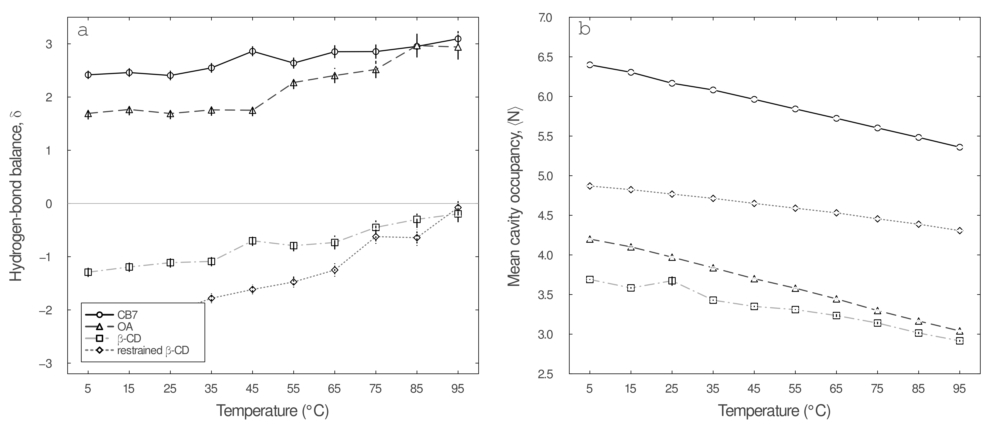

# Molecular Confinement Does Not Create High-Energy Water

**A computational study of hydration thermodynamics and collective drying in CB7, OA, and β-cyclodextrin**  
Jakob L. Schanzer · manuscript in preparation


## The question

Water release is often invoked as a universal explanation for strong host–guest binding: confinement supposedly creates energetically unfavorable, or “high-energy,” water that is expelled when a guest enters. This project asks whether that picture survives direct, spatially resolved thermodynamic analysis.

The answer is **no—not as a general rule**. Across the three manuscript hosts, populated hydration sites are on average enthalpically stabilized relative to bulk water. Rigid, hydrophobic cavities can still undergo sharp collective drying as a guest approaches, but a drying transition does not by itself establish a favorable high-energy-water release mechanism.

## Results at a glance

### Binding thermodynamics separate direct and solvent-mediated forces


The potential of mean force is decomposed into direct host–guest and solvent-mediated contributions. At 298 K, the approximate PMF minima are −110.4 kJ mol⁻¹ for CB7, −56.5 kJ mol⁻¹ for OA, and −31.9 kJ mol⁻¹ for restrained β-CD. The balance of enthalpy and entropy differs substantially across hosts, demonstrating that similar language about “water release” can conceal different physical mechanisms.

### Drying can be collective or gradual


CB7 and OA exhibit narrow spatial transitions between wet and dry cavity states, with 25–75% transition widths of approximately 0.92 Å and 0.61 Å. Restrained β-CD dries more gradually and asymmetrically (approximately 2.21 Å and 1.19 Å at its two portals). These are equilibrium changes along a binding coordinate—not kinetic drying rates.

### Temperature perturbs hydrogen bonding and occupancy



From 5 to 95 °C, average cavity populations decrease from about 6.40 to 5.36 waters in CB7, 4.20 to 3.04 in OA, 4.87 to 4.31 in restrained β-CD, and 3.69 to 2.92 in unrestrained β-CD. The joint temperature response distinguishes changes in water population from changes in local hydrogen-bond coordination.

## What the code does

```text
trajectory / energies
        │
        ├── JANAL (Fortran) ── density, energy, chemical potential,
        │                       fluctuations, occupancy distributions
        ├── H-bond analysis ── water–water and water–host networks
        └── geometry tools ─── host orientation and cavity membership
                                  │
                                  ▼
                         processed workbooks
                                  │
                                  ▼
                 Julia analysis + uncertainty propagation
                                  │
                                  ▼
                  publication figures and quantitative checks
```

The production design separates a shared JANAL analysis core from a geometry-specific cavity module. Each host uses its own `vol` input and, where its geometry requires it, an adapted `vol.f` backend. The checked-in backend is a six-plane polyhedral implementation; it is an example of that interface, not a claim that one volume definition fits every host.

## Repository tour

| Path | Purpose |
|---|---|
| `src/fortran/host_analysis/` | Shared JANAL core and geometry-specific volume interface |
| `src/fortran/hydrogen_bonds/` | Hydrogen-bond and bridging-water analysis |
| `src/fortran/ring_geometry/` | β-CD ring orientation and spacing analysis |
| `src/python/` | Occupancy counting and deterministic aggregation |
| `analysis/` | Reproducible Julia figure and transition analyses |
| `data/processed/` | Compact inputs for the displayed manuscript analyses |
| `data/derived/` | Bootstrap errors and derived summary tables |
| `figures/` | Results placed first for rapid scientific review |
| `docs/` | Methods, data provenance, validation, and agentic workflow |

## Reproduce the checks

Requirements: GNU Fortran, Python 3.10+, and Julia 1.10+.

```bash
# Compile all Fortran programs and perform static repository checks
make check

# Run deterministic Python unit tests
make test

# Install the Julia environment once, then regenerate all analysis figures
julia --project=. -e 'using Pkg; Pkg.instantiate()'
make figures
```

See [Methods](docs/METHODS.md), [Data dictionary](docs/DATA_DICTIONARY.md), [Validation](docs/VALIDATION.md), [Volume backends](docs/VOLUME_BACKENDS.md), and [Agentic workflow](docs/AGENTIC_WORKFLOW.md) for the assumptions behind those commands.

## Scope and confidentiality

Only the three systems disclosed in the manuscript—CB7, OA, and β-CD (including the restrained β-CD protocol)—are represented here. Raw trajectories are not included. This repository is private because the manuscript is not yet published; permission to view does not imply permission to redistribute.

